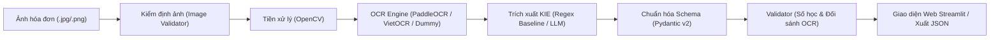

# Nghiên cứu ứng dụng OCR kết hợp Mô hình Ngôn ngữ Lớn để trích xuất thông tin trên ảnh hóa đơn bán lẻ Việt Nam

> **Tên tiếng Anh:** Combining OCR and Large Language Models for Key Information Extraction from Vietnamese Retail Receipt Images  
> **Lĩnh vực:** Document AI (Computer Vision & Natural Language Processing)  
> **Thời gian thực hiện:** 19/10/2026 – 13/12/2026 (08 tuần)  
> **Giảng viên hướng dẫn:** ThS. Nguyễn Hữu Trung  
> **Nhóm sinh viên thực hiện:**
> - Nguyễn Minh Luân (Chủ nhiệm) - Điều phối, thiết kế Schema JSON, Prompt Engineering, thực nghiệm LLM
> - Đặng Thanh Hòa - Thu thập & gán nhãn dữ liệu, tiền xử lý ảnh và pipeline OCR
> - Nguyễn Thành Trung - Baseline Regex, Validator logic, API và Web Demo

---

## 1. Cấu trúc thư mục dự án

Toàn bộ mã nguồn, cấu hình, kiểm thử và dữ liệu phần mềm được quản lý duy nhất tại thư mục này:

```text
D:\NCKH\OCR_LLM_Vietnamese_Receipt_Extraction\
├── README.md                           # Hướng dẫn chi tiết dự án
├── .gitignore                          # Loại trừ .venv, ảnh nhạy cảm, checkpoint lớn
├── requirements.txt                    # Thư viện phụ thuộc cho giai đoạn MVP
├── .env.example                        # Mẫu biến môi trường (API key, cấu hình)
├── pyproject.toml                      # Cấu hình đóng gói module và pytest
├── src/                                # Mã nguồn chính của hệ thống
│   └── receipt_extraction/
│       ├── __init__.py
│       ├── config.py                   # Cấu hình tập trung, đọc env và quản lý paths
│       ├── schemas/                    # Pydantic Schemas (ReceiptData, Item, Issues)
│       ├── preprocess/                 # Kiểm định ảnh (validator) & tiền xử lý OpenCV
│       ├── ocr/                        # OCR Engines (Dummy, Tesseract, VietOCR, PaddleOCR)
│       ├── extraction/                 # Module KIE (Baseline Regex B1, Adapter LLM)
│       ├── validation/                 # Kiểm định ràng buộc nghiệp vụ, chống Hallucination
│       └── web/                        # Giao diện Web Demo MVP (Streamlit)
├── tests/                              # Bộ kiểm thử tự động (Unit Tests)
├── configs/                            # Cấu hình prompt templates & schemas
├── data/                               # Quản lý dữ liệu phân tầng
│   ├── raw/                            # Ảnh gốc thu thập (không commit Git)
│   ├── interim/                        # Dữ liệu trung gian sau tiền xử lý
│   ├── processed/                      # Dữ liệu chuẩn hóa kèm nhãn
│   ├── annotations/                    # Nhãn JSON từ Label Studio
│   └── samples/                        # Ảnh mẫu thử nghiệm đã ẩn danh
├── notebooks/                          # Google Colab / Kaggle Jupyter Notebooks
├── experiments/                        # Quản lý log thực nghiệm (F1, CER, WER, VRAM)
├── scripts/                            # Tiện ích thu thập, gán nhãn, xuất báo cáo
├── docs/                               # Tài liệu thiết kế kỹ thuật
└── artifacts/                          # Kết quả đầu ra và model checkpoints
```

---

## 2. Kiến trúc Pipeline Sản phẩm (End-to-End)



---

## 3. Hướng dẫn cài đặt & chạy trên Windows

### Bước 1: Cài đặt Python 3.10
Nếu máy tính của bạn chưa có Python, mở PowerShell (quyền Admin) và chạy:
```powershell
winget install --id Python.Python.3.10 --source winget --accept-package-agreements --accept-source-agreements
```

### Bước 2: Tạo môi trường ảo (.venv)
Mở PowerShell tại thư mục dự án:
```powershell
cd D:\NCKH\OCR_LLM_Vietnamese_Receipt_Extraction
python -m venv .venv
.\.venv\Scripts\Activate.ps1
```

### Bước 3: Cài đặt thư viện phụ thuộc
```powershell
pip install --upgrade pip
pip install -r requirements.txt
```

### Bước 4: Chạy kiểm thử tự động (Unit Tests)
```powershell
pytest
```

### Bước 5: Khởi động Giao diện Web MVP (Streamlit)
```powershell
streamlit run src\receipt_extraction\web\app.py
```
Ứng dụng sẽ tự động mở tại địa chỉ `http://localhost:8501`.

---

## 4. Trạng thái các chức năng hiện tại

| Module / Chức năng | Trạng thái hiện tại | Ghi chú |
| :--- | :---: | :--- |
| **Kiểm định tệp ảnh đầu vào** | ✅ Hoàn thành | Kiểm tra định dạng, kích thước, độ mờ (Laplacian), decode |
| **Tiền xử lý ảnh (OpenCV)** | ✅ Hoàn thành | CLAHE cân bằng tương phản, chuẩn hóa kích thước |
| **OCR Dummy Engine (Mock)** | ✅ Hoàn thành | Phục vụ kiểm thử offline và demo luồng MVP không phụ thuộc model nặng |
| **Tesseract OCR Adapter** | ✅ Hoàn thành | Sẵn sàng tích hợp khi cài tesseract binary |
| **VietOCR & PaddleOCR** | ⏳ Lên lịch Tuần 3 | Triển khai sau khi chuẩn hóa bộ nhãn 100 ảnh CER |
| **Baseline B1 (Regex Heuristic)** | ✅ Hoàn thành | Bóc tách tên cửa hàng, MST, ngày giờ, số tiền, tạm tính, VAT |
| **LLM Adapter Interface** | ✅ Hoàn thành | Báo lỗi minh bạch khi chưa cấu hình API key / model |
| **Validator nghiệp vụ** | ✅ Hoàn thành | Kiểm tra `subtotal - discount + vat == total`, phát hiện Hallucination |
| **Web Demo Streamlit** | ✅ Hoàn thành | Upload ảnh $\rightarrow$ OCR $\rightarrow$ JSON $\rightarrow$ Cảnh báo $\rightarrow$ Tải JSON |

---

## 5. Nguyên tắc Khoa học & Bảo vệ Dữ liệu
- **Không tự tạo số liệu giả định:** Toàn bộ bảng đánh giá CER, WER, F1 chỉ được điền sau khi chạy thực tế trên tập test.
- **Ẩn danh dữ liệu (Anonymization):** Mọi ảnh hóa đơn thu thập thực tế phải được che mờ số thẻ ngân hàng, họ tên khách hàng và số điện thoại cá nhân trước khi đưa vào kho dữ liệu.
- **Phân tách tập dữ liệu nghiêm ngặt:** Tập Train, Validation và Test độc lập hoàn toàn, không để lọt hóa đơn của cùng một lần mua sắm vào nhiều tập.
