# Nghiên cứu Ứng dụng OCR Kết hợp Mô hình Ngôn ngữ Lớn để Trích xuất Thông tin trên Ảnh Hóa đơn Bán lẻ Việt Nam

<div align="center">

**Combining OCR and Large Language Models for Key Information Extraction from Vietnamese Retail Receipt Images**

[](https://www.python.org/)
[](https://opencv.org/)
[](https://github.com/tesseract-ocr/tesseract)
[](https://docs.pydantic.dev/)
[](https://streamlit.io/)
[](./tests)

*Đề tài Nghiên cứu Khoa học Sinh viên — Năm học 2026–2027*

</div>

---

## 📋 Thông tin Chung về Đề tài (Project Metadata)

| Hạng mục | Nội dung chi tiết |
| :--- | :--- |
| **Tên đề tài (VI)** | Nghiên cứu ứng dụng OCR kết hợp mô hình ngôn ngữ lớn để trích xuất thông tin trên ảnh hóa đơn bán lẻ Việt Nam |
| **Tên đề tài (EN)** | *Combining OCR and Large Language Models for Key Information Extraction from Vietnamese Retail Receipt Images* |
| **Lĩnh vực nghiên cứu** | Trí tuệ Nhân tạo / Xử lý Tài liệu Thông minh (*Document AI, Computer Vision & Natural Language Processing*) |
| **Thời gian thực hiện** | 19/10/2026 – 13/12/2026 (08 tuần) |
| **Giảng viên hướng dẫn** | **ThS. Nguyễn Hữu Trung** |
| **Nhóm nghiên cứu** | • **Nguyễn Minh Luân** *(Chủ nhiệm đề tài)* — Kiến trúc hệ thống, Thiết kế Schema JSON, Prompt Engineering & Thực nghiệm LLM<br>• **Đặng Thanh Hòa** *(Thành viên)* — Thu thập & Gán nhãn dữ liệu, Tiền xử lý ảnh OpenCV & Thực nghiệm OCR<br>• **Nguyễn Thành Trung** *(Thành viên)* — Xây dựng Baseline Regex, Logic kiểm định (Validator), API & Giao diện Web |

---

## 🎯 1. Tóm tắt & Đặt vấn đề (Abstract & Motivation)

Hóa đơn bán lẻ tại Việt Nam (siêu thị, cửa hàng tiện lợi, quán ăn, nhà thuốc) phần lớn được in trên giấy nhiệt với nhiều thách thức đặc thù: **phông chữ in nhiệt mờ hoặc đứt nét, ảnh chụp bằng điện thoại bị nghiêng/thiếu sáng, bố cục phi cấu trúc, tiếng Việt có dấu phức tạp và tên mặt hàng viết tắt không đồng nhất**.

Các công cụ nhận dạng ký tự quang học (OCR) truyền thống chỉ dừng lại ở việc chuyển hình ảnh thành chuỗi văn bản thô (*unstructured text*) với tỷ lệ nhiễu nhất định và không thể tự động hiểu ngữ nghĩa để tách thành các trường dữ liệu kế toán. Ngược lại, các phương pháp dựa trên biểu thức chính quy (*Rule-based / Regex*) dễ bị gãy khi gặp mẫu hóa đơn mới.

**Mục tiêu của đề tài:** Xây dựng và thực nghiệm một đường ống (*pipeline*) kết hợp **Tiền xử lý ảnh (OpenCV) + Nhận dạng văn bản (OCR) + Mô hình Ngôn ngữ Lớn (LLM) + Bộ kiểm định nghiệp vụ (Deterministic Validator)** nhằm chuyển đổi ảnh hóa đơn bán lẻ Việt Nam thành dữ liệu JSON có cấu trúc chuẩn xác, đồng thời phát hiện sai lệch số học và ngăn chặn hiện tượng ảo giác (*hallucination*).

---

## 🏗️ 2. Kiến trúc Hệ thống (System Architecture)

Hệ thống được thiết kế theo kiến trúc phân tách mô-đun (*Modular Pipeline*), cho phép hoán đổi độc lập từng thành phần để phục vụ đánh giá thực nghiệm khoa học:

```mermaid
flowchart LR
    A["📷 Ảnh Hóa đơn<br/>(.jpg, .png, .webp)"] --> B["🔍 Image Validator<br/>(Kích thước, Độ mờ)"]
    B --> C["🛠️ OpenCV Preprocessor<br/>(CLAHE, Deskew, Threshold)"]
    C --> D["🔤 OCR Engines<br/>(Tesseract / VietOCR / PaddleOCR)"]
    D --> E["🧠 KIE Extractors<br/>(Regex B1 / LLM Zero & Few-shot)"]
    E --> F["📐 Pydantic Schema<br/>(Chuẩn hóa 12 trường JSON)"]
    F --> G["🛡️ Receipt Validator<br/>(Đối chiếu số học & Chống ảo giác)"]
    G --> H["💻 Streamlit Web UI<br/>& JSON/CSV Export"]
```



### Quy chuẩn 12 Trường Thông tin Trích xuất (Target JSON Schema)

Mọi phương pháp trích xuất trong đề tài đều chuẩn hóa đầu ra về mô hình dữ liệu [`ReceiptData`](./src/receipt_extraction/schemas/receipt.py):

| Nhóm thông tin | Tên trường (`Field`) | Kiểu dữ liệu | Mô tả nghiệp vụ |
| :--- | :--- | :---: | :--- |
| **Định danh đơn vị** | `seller_name` | `Optional[str]` | Tên cửa hàng, siêu thị hoặc đơn vị bán hàng |
| | `seller_address` | `Optional[str]` | Địa chỉ chi nhánh/cửa hàng |
| | `tax_id` | `Optional[str]` | Mã số thuế doanh nghiệp (10 hoặc 13 chữ số) |
| **Thông tin giao dịch** | `invoice_number` | `Optional[str]` | Mã số hóa đơn / Số phiếu thanh toán |
| | `timestamp` | `Optional[str]` | Ngày và giờ xuất hóa đơn |
| | `payment_method` | `Optional[str]` | Hình thức thanh toán (Tiền mặt, Chuyển khoản, Thẻ, Ví điện tử) |
| **Danh sách mặt hàng** | `items` | `List[ReceiptItem]` | Danh sách các món hàng: `item_name`, `quantity`, `unit_price`, `total_price` |
| **Tổng hợp tài chính** | `subtotal` | `Optional[int]` | Tổng tiền hàng tạm tính trước thuế và giảm giá (VNĐ) |
| | `discount` | `Optional[int]` | Số tiền chiết khấu / khuyến mãi / giảm giá (VNĐ) |
| | `vat_amount` | `Optional[int]` | Tiền thuế Giá trị gia tăng — GTGT / VAT (VNĐ) |
| | `total_cost` | `Optional[int]` | **Tổng số tiền thanh toán cuối cùng (VNĐ)** *(Trường bắt buộc)* |

---

## 🔬 3. Phương pháp Nghiên cứu & Thiết kế Thực nghiệm (Methodology)

Đề tài thiết kế chuỗi thực nghiệm đối chứng theo cấp độ phức tạp tăng dần:

1. **Thực nghiệm Tiền xử lý & OCR (*OCR Benchmarking*):**
   - Đánh giá ảnh hưởng của tiền xử lý OpenCV (cân bằng sáng CLAHE, khử nghiêng Deskew, nhị phân hóa Adaptive Thresholding).
   - So sánh hiệu năng nhận dạng tiếng Việt giữa **Tesseract OCR (`vie+eng`)**, **VietOCR** và **PaddleOCR** thông qua hai chỉ số: **CER** (*Character Error Rate*) và **WER** (*Word Error Rate*).
2. **Thực nghiệm Trích xuất Thông tin (*Key Information Extraction — KIE*):**
   - **Baseline B1 (`regex_baseline`):** Sử dụng biểu thức chính quy kết hợp luật kinh nghiệm (*Heuristics*) hỗ trợ cả văn bản tiếng Việt có dấu và không dấu.
   - **Phương pháp B2 (`llm_zero_shot`):** Trích xuất bằng LLM sử dụng System Prompt định nghĩa Schema JSON mà không cần mẫu ví dụ.
   - **Phương pháp B3 (`llm_few_shot`):** Cung cấp $k=3$ ví dụ mẫu (*In-Context Learning*) đại diện cho các bố cục hóa đơn khác nhau.
   - **Thí nghiệm Oracle (*Error Isolation*):** Đưa văn bản Ground-Truth OCR vào LLM để tách biệt lỗi do tầng OCR gây ra với lỗi suy luận của tầng LLM.
3. **Kiểm định Ràng buộc Số học & Chống Ảo giác (*Validation & Anti-Hallucination*):**
   - Kiểm tra công thức kế toán: $\text{Subtotal} - \text{Discount} + \text{VAT} = \text{Total Cost}$ và $\sum \text{Item Total} = \text{Subtotal}$ (cho phép dung sai làm tròn $\pm 1.000\text{ VNĐ}$).
   - Đối chiếu sự tồn tại thực tế của `total_cost` và `tax_id` trong văn bản OCR gốc nhằm phát hiện các trường hợp mô hình tự sinh số liệu không có trên ảnh (*Hallucination*).

---

## 📂 4. Cấu trúc Thư mục Dự án (Repository Structure)

```text
OCR_LLM_Vietnamese_Receipt_Extraction/
├── README.md                           # Tài liệu tổng quan và hướng dẫn học thuật của dự án
├── pyproject.toml                      # Cấu hình đóng gói package Python và pytest
├── requirements.txt                    # Danh sách thư viện phụ thuộc (cố định phiên bản tối thiểu)
├── .env.example                        # Mẫu cấu hình biến môi trường (API Keys, đường dẫn OCR)
├── .gitignore                          # Quy tắc loại trừ môi trường ảo, dữ liệu thô nhạy cảm
├── src/
│   └── receipt_extraction/
│       ├── __init__.py
│       ├── config.py                   # Quản lý cấu hình tập trung (Environment & Paths)
│       ├── schemas/
│       │   └── receipt.py              # Pydantic v2 Schemas (ReceiptData, ExtractionResult, ValidationIssue)
│       ├── preprocess/
│       │   ├── image_validator.py      # Kiểm định định dạng, độ phân giải và độ mờ (Laplacian Variance)
│       │   └── preprocessor.py         # Tiền xử lý OpenCV (CLAHE, Deskew, Grayscale, Adaptive Threshold)
│       ├── ocr/
│       │   ├── base.py                 # Giao diện trừu tượng BaseOCREngine & cấu trúc OCRResult
│       │   ├── tesseract_ocr.py        # Adapter Tesseract OCR thực tế (hỗ trợ tiếng Việt + bounding boxes)
│       │   ├── dummy_ocr.py            # Engine giả lập phục vụ kiểm thử đơn vị ngoại tuyến (Unit Testing)
│       │   └── factory.py              # Factory khởi tạo và kiểm tra trạng thái sẵn sàng của OCR Engine
│       ├── extraction/
│       │   ├── base.py                 # Giao diện trừu tượng BaseExtractor
│       │   ├── regex_baseline.py       # Baseline B1: Trích xuất bằng Regex & Heuristics
│       │   └── llm_extractor.py        # Giao diện tích hợp LLM (Zero-shot / Few-shot Structured Extraction)
│       ├── validation/
│       │   └── receipt_validator.py    # Kiểm định nghiệp vụ số học & phát hiện ảo giác (Hallucination Check)
│       └── web/
│           └── app.py                  # Ứng dụng Web Demo tương tác xây dựng bằng Streamlit
├── tests/                              # Bộ kiểm thử tự động (30 Unit & Integration Tests)
├── scripts/
│   └── test_pipeline.py                # Kịch bản kiểm thử luồng End-to-End qua giao diện dòng lệnh (CLI)
├── data/
│   ├── tessdata/                       # Mô hình ngôn ngữ Tesseract (vie.traineddata, eng.traineddata)
│   ├── samples/                        # Ảnh hóa đơn tổng hợp phục vụ kiểm thử tự động
│   ├── raw/                            # Ảnh hóa đơn gốc (loại trừ khỏi Git để bảo mật thông tin)
│   ├── interim/                        # Dữ liệu trung gian sau tiền xử lý
│   ├── processed/                      # Tập dữ liệu chuẩn hóa phục vụ đánh giá
│   └── annotations/                    # Nhãn Ground-Truth định dạng JSON
├── configs/                            # Lưu trữ Prompt Templates và cấu hình thực nghiệm
├── experiments/                        # Kết quả định lượng (CER, WER, Precision, Recall, F1-score)
├── notebooks/                          # Jupyter Notebooks phân tích dữ liệu và trực quan hóa kết quả
└── docs/                               # Tài liệu thiết kế kỹ thuật và đặc tả gán nhãn dữ liệu
```

---

## 🚀 5. Hướng dẫn Cài đặt & Tái lập Thực nghiệm (Installation & Reproducibility)

### Yêu cầu Hệ thống
- **Hệ điều hành:** Windows 10/11 (64-bit), Linux hoặc macOS.
- **Python:** Phiên bản `3.10` trở lên.
- **Phần mềm OCR:** [Tesseract OCR](https://github.com/UB-Mannheim/tesseract/wiki) (phiên bản 5.x).

### Bước 1: Sao chép kho mã nguồn (Clone Repository)
```powershell
git clone https://github.com/0xluan-arc/OCR_LLM_Vietnamese_Receipt_Extraction.git
cd OCR_LLM_Vietnamese_Receipt_Extraction
```

### Bước 2: Khởi tạo môi trường ảo và cài đặt thư viện
```powershell
python -m venv .venv
.\.venv\Scripts\Activate.ps1
pip install --upgrade pip
pip install -r requirements.txt
pip install -e .
```

### Bước 3: Cài đặt Tesseract OCR (Dành cho Windows)
Nếu máy trạm chưa cài đặt binary Tesseract OCR, chạy lệnh sau trong PowerShell:
```powershell
winget install --id UB-Mannheim.TesseractOCR --source winget --accept-package-agreements --accept-source-agreements
```
*(Gói ngôn ngữ tiếng Việt `vie.traineddata` và tiếng Anh `eng.traineddata` đã được tích hợp sẵn tại thư mục `data/tessdata/`, hệ thống sẽ tự động nạp mà không cần cấu hình thủ công).*

### Bước 4: Chạy bộ kiểm thử tự động (Unit & Integration Tests)
```powershell
pytest -v
```
Kết quả mong đợi: `30 passed` (bao gồm kiểm thử Schema, Image Validator, OpenCV Preprocessor, Tesseract OCR Adapter, Regex Baseline và Receipt Validator).

### Bước 5: Chạy kiểm thử luồng End-to-End bằng CLI
```powershell
python scripts/test_pipeline.py --engine tesseract
```

### Bước 6: Khởi chạy Ứng dụng Web Demo (Streamlit)
```powershell
streamlit run src/receipt_extraction/web/app.py
```
Truy cập địa chỉ `http://localhost:8501` trên trình duyệt để tải ảnh hóa đơn lên, tùy chỉnh bộ lọc OpenCV, quan sát văn bản OCR, kiểm tra cảnh báo nghiệp vụ và tải xuống tệp JSON chuẩn hóa.

---

## 📊 6. Tiến độ Triển khai & Hiện trạng Dự án (Implementation Roadmap)

| Giai đoạn | Hạng mục công việc | Trạng thái | Ghi chú kỹ thuật |
| :---: | :--- | :---: | :--- |
| **Giai đoạn 1** | Khởi tạo kiến trúc dự án, chuẩn hóa Schema JSON 12 trường | ✅ Hoàn thành | Sử dụng Pydantic v2 (`ReceiptData`, `ExtractionResult`) |
| **Giai đoạn 2A** | Kiểm định ảnh, Tiền xử lý OpenCV & Tích hợp Tesseract OCR thật | ✅ Hoàn thành | Hỗ trợ `vie+eng`, CLAHE, Deskew; đạt 30/30 bài kiểm thử |
| **Giai đoạn 2B** | Xây dựng Baseline B1 (Regex/Heuristics), Validator & Web Demo | ✅ Hoàn thành | Bắt từ khóa tiếng Việt có/không dấu, kiểm tra tổng số học |
| **Giai đoạn 3** | Chuẩn bị bộ dữ liệu MC-OCR 2021 & Thu thập, gán nhãn hóa đơn thực tế | 🔄 Đang thực hiện | Áp dụng quy trình ẩn danh hóa thông tin nhạy cảm |
| **Giai đoạn 4** | Tích hợp VietOCR / PaddleOCR & Thực nghiệm LLM (Zero-shot / Few-shot) | ⏳ Theo kế hoạch | Đánh giá CER/WER và F1-score trên tập Test độc lập |
| **Giai đoạn 5** | Phân tích lỗi (Oracle Experiment) & Hoàn thiện Báo cáo Tổng kết | ⏳ Theo kế hoạch | Tổng hợp bảng biểu thực nghiệm và đóng gói sản phẩm |

---

## 🛡️ 7. Cam kết Đạo đức Nghiên cứu & Bảo mật Dữ liệu (Research Integrity & Privacy)

1. **Tính trung thực khoa học:** Toàn bộ kết quả đánh giá định lượng (CER, WER, Precision, Recall, F1-score, độ trễ xử lý) chỉ được công bố sau khi chạy thực nghiệm thực tế trên tập kiểm thử độc lập. Hệ thống phân biệt minh bạch giữa chế độ kiểm thử giả lập (`dummy`) và chế độ nhận dạng thực tế (`tesseract`).
2. **Bảo vệ dữ liệu cá nhân (*Data Anonymization*):** Không đưa ảnh hóa đơn chứa thông tin nhận dạng cá nhân (PII) như họ tên khách hàng, số điện thoại cá nhân hoặc số thẻ ngân hàng lên kho mã nguồn công khai.
3. **Khả năng tái lập (*Reproducibility*):** Mọi kịch bản tiền xử lý, cấu hình tham số và bộ kiểm thử đều được quản lý phiên bản trên Git để đảm bảo khả năng kiểm chứng độc lập.

---

## 📄 Giấy phép & Trích dẫn (License & Citation)

Dự án được phát triển phục vụ mục đích học thuật và nghiên cứu khoa học sinh viên tại Khoa Công nghệ Thông tin. Nếu bạn tham khảo mã nguồn hoặc kiến trúc của dự án, vui lòng trích dẫn:

```bibtex
@misc{luan2026vnreceiptkie,
  title        = {Combining OCR and Large Language Models for Key Information Extraction from Vietnamese Retail Receipt Images},
  author       = {Nguyen, Minh Luan and Dang, Thanh Hoa and Nguyen, Thanh Trung and Nguyen, Huu Trung},
  year         = {2026},
  howpublished = {\url{https://github.com/0xluan-arc/OCR_LLM_Vietnamese_Receipt_Extraction}},
  note         = {Student Scientific Research Project}
}
```
